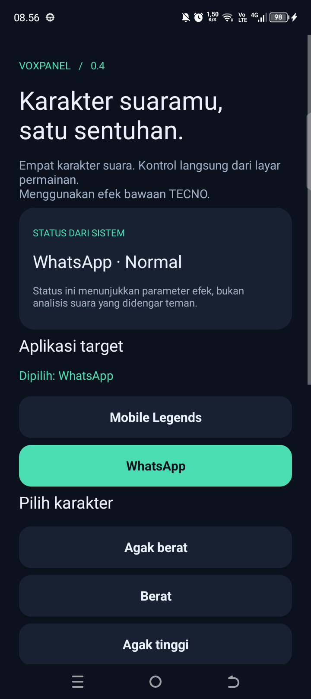
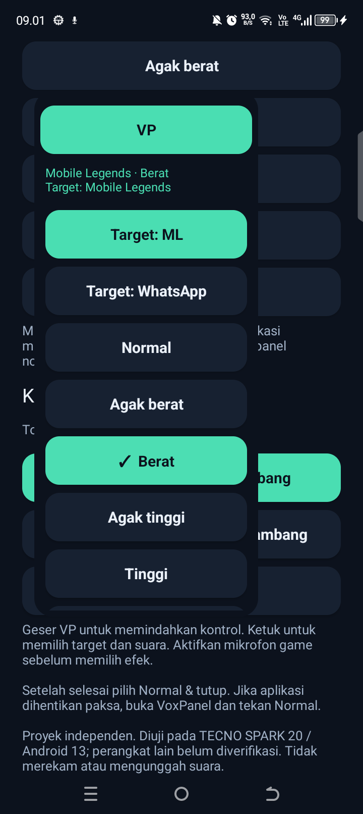
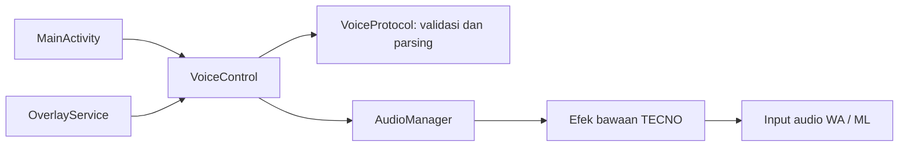

# VoxPanel

**Ganti karakter suara, tetap di permainan.**

VoxPanel adalah aplikasi Android native dengan panel mengambang untuk memilih efek suara bawaan TECNO. Empat preset dan Normal dapat dikontrol dari layar utama atau langsung dari panel di atas WhatsApp dan Mobile Legends.





Proyek independen untuk portofolio. Tidak berafiliasi dengan TECNO, WhatsApp, atau Mobile Legends. Kode integrasi ditulis dalam proyek ini; library proprietary dan hasil dekompilasi vendor tidak disertakan.

## Fitur

- Empat karakter: **Agak berat**, **Berat**, **Agak tinggi**, dan **Tinggi**.
- Kontrol **Normal** untuk kembali ke suara asli.
- Panel **VP** yang dapat digeser, diperkecil, dan digulir di landscape.
- Pilihan target WhatsApp/Mobile Legends langsung di panel.
- Status parameter vendor dan indikator target/efek yang terbaca.
- Posisi kontrol tersimpan per orientasi.
- Foreground service dengan tindakan **Normal & tutup** pada notifikasi.
- Tidak meminta mikrofon, internet, aksesibilitas, atau root.

## Kompatibilitas dan hasil uji

| Lingkungan | Bukti |
|---|---|
| TECNO SPARK 20 / KJ5n, Android 13 | Perangkat uji |
| Panggilan WhatsApp | Pengguna mengonfirmasi empat efek dan Normal terdengar berbeda |
| Voice chat Mobile Legends | Pengguna mengonfirmasi suara berubah dan lancar, termasuk saat pertandingan |
| Panel mengambang 0.3 | Pengguna mengonfirmasi berfungsi dan lancar |
| Penyempurnaan 0.4.0 | Lihat [catatan validasi](docs/TESTING.md) |
| HP atau firmware lain | Belum diverifikasi |

VoxPanel memakai jalur vendor `TranMagiqueMode=<package>,<preset>`. Ini integrasi khusus perangkat, bukan virtual microphone universal. Respons parameter tidak membuktikan suara yang didengar penerima; uji percakapan tetap diperlukan. Proyek tidak menyediakan voice cloning, suara AI, atau pitch custom untuk aplikasi target.

## Penggunaan

1. Pasang APK debug dari build sendiri atau artefak CI repositori ini.
2. Buka **VoxPanel**, pilih WhatsApp atau Mobile Legends.
3. Aktifkan mikrofon di aplikasi target lalu pilih karakter.
4. Untuk overlay, tekan **Tampilkan tombol mengambang**, izinkan **Tampil di atas aplikasi lain**, dan kembali ke VoxPanel. Notifikasi menyediakan kontrol tambahan jika diizinkan.
5. Ketuk **VP** untuk membuka panel, geser untuk memindahkan, dan pilih **Normal & tutup** setelah selesai.

Jika aplikasi target mereset efek saat mikrofon dinyalakan, terapkan kembali lewat panel. Force stop/reboot tidak menjamin callback reset; periksa Normal secara manual sebelum melanjutkan atau menghapus aplikasi.

## Build di Android Studio

Persyaratan: **JDK 17**, Android SDK Platform **33**, Build Tools **34.0.0**, dan koneksi internet untuk dependensi build pertama. Buka folder repositori di Android Studio dan gunakan Gradle wrapper. Identitas paket `id.local.tecnovoiceprobe` dipertahankan untuk kompatibilitas dengan prototipe awal.

```bash
# Linux / macOS
bash ./gradlew testDebugUnitTest lintDebug assembleDebug
```

```powershell
# Windows
.\gradlew.bat testDebugUnitTest lintDebug assembleDebug
```

APK: `app/build/outputs/apk/debug/app-debug.apk`.

Wrapper Gradle 8.9 disertai checksum distribusi. Plugin Android Gradle dikunci ke 8.7.3. Target SDK tetap 33 untuk perangkat eksperimen Android 13; ini belum merupakan persiapan distribusi Play Store.

Setiap pengembang memakai debug keystore lokal. Jika APK lama ditandatangani kunci berbeda, pembaruan ditolak Android. Gunakan keystore yang sama melalui `-PvoxpanelDebugKeystore=/path/to/debug.keystore`, atau reset Normal dan uninstall versi lama sebelum menginstal build baru. Jangan memasukkan keystore ke Git.

Script [build.ps1](build.ps1) dipertahankan untuk build lokal Windows tanpa Gradle, memakai JDK/SDK yang telah terpasang:

```powershell
.\build.ps1 -JavaHome $env:JAVA_HOME -AndroidSdkRoot $env:ANDROID_HOME
```

Jalur script lokal ini mendukung Build Tools 34.0.0 (fallback 33.0.2) dan menghasilkan `build/tecno-voice-probe.apk`. Jalur Gradle di atas adalah build standar untuk kontributor dan CI.

## Arsitektur



Pemrosesan suara dilakukan komponen vendor. VoxPanel mengatur preset dan membaca parameternya; tidak mengambil alih mikrofon atau mengirim audio ke server.

## Dokumentasi

- [Privasi dan izin](docs/PRIVACY.md)
- [Pengujian dan checklist perangkat](docs/TESTING.md)
- [Studi kasus untuk portofolio](docs/PORTFOLIO.md)
- [Riset batas suara custom](CUSTOM-VOICE-RESEARCH.md)
- [Changelog](CHANGELOG.md)
- [Menyiapkan GitHub](docs/GITHUB.md)

## Lisensi

[MIT](LICENSE) untuk kode proyek ini. Dependensi build dan komponen vendor tetap mengikuti lisensi pemiliknya masing-masing. Tidak ada binary vendor yang didistribusikan di repositori.
